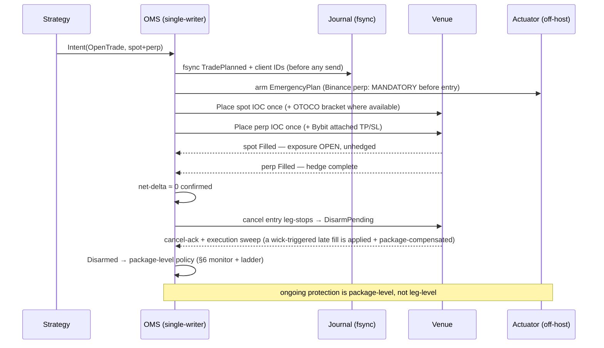

# Funding-Rate Arbitrage Platform — Engineering Build-Spec (MVP)

**Status:** Draft v0.6 (2026-07-18) — Codex adversarial rounds 1–4 (11 → 6 → 4 → 4) **plus two external human reviews (R1, R2) and three Codex convergence rounds** (8 + 5 + 3 findings — all applied). The rounds converged the execution / account / economics layers but repeatedly deepened **one** area: the **off-host emergency actuator is a bounded distributed-systems subproject** (§7.4) whose takeover protocol must be built + chaos-tested, not finished in prose. v0.6 resolves the reviewers' account/margin-mode, forecasting-model, protection-lifecycle (disarm + fence-first takeover), spot-leg-surface, durability, and scope-tiering findings; all new venue facts re-verified against official docs 2026-07-18. **Deliberately not "converged":** it is implementation-ready *by capital tier* (§1.1) — the **foundation + read-path + edge-proof (milestones 1–2) are fully build-ready**, and go-live is **de-risked via a sub-`$1K` canary** (§12 / §7.4) so the actuator protocol is proven in production-lite before real size. Before real capital: an empirical testnet liquidation test of the §4.1 posture. Open polish: a "what changed" tutorial appendix.
**Relation to other docs:** `docs/legacy/` is the frozen research record (the "why"). `docs/review/2026-07-18-05-tutorial-critical-review.md` is the critical review this spec resolves. `docs/tutorial.md` is the teaching companion. This spec is the normative "what to build."
**Conventions:** MUST / SHOULD / MAY are normative. Requirements that resolve a review finding are tagged `[→ P#/C#/A#/S#/B#]`; architecture decisions `[→ D#]`; Codex-round resolutions `[→ X#/Y#/Z#]`; **external-review (R1/R2) resolutions `[→ R1-F#, R2-#, R1-meta]`**. A traceability table is in the Appendix.
**House style:** Go, **DDD + hexagonal (ports/adapters)**, mirroring the reference backend (`bitnet-backend-go`: bounded contexts, `internal/{boundary,engine,platform}`, ports in `application/ports/`, `infrastructure/ = driven/ + driving/`, compile-time port assertions, explicit `module.go` wiring — no DI container) **and** NautilusTrader's engine design (single-writer execution/portfolio state, central event dispatch, deterministic backtest-live parity). Open-source frameworks are **reference/inspiration only — never dependencies**; `internal/platform/*` is reimplemented fresh, not imported.

---

## 1. Product scope & non-goals

**Goal.** A multi-exchange funding-rate arbitrage platform. The platform is a **strategy-agnostic foundation** that runs pluggable, parametrized **strategies**. The MVP proves the foundation end-to-end with **cash-and-carry** on **Binance + Bybit**, built **N-venue-ready** from day one.

**MVP scope.**
- Venues: Binance (spot + USDⓈ-M linear perp) and Bybit (spot + linear perp). Adding a venue = implement one adapter (§4).
- Strategy #1 (proven first): **cash-and-carry** — long spot + short perp on the same venue, harvesting positive funding.
- Strategy #2 (next): **cross-exchange spread** — long perp on the low-funding venue, short perp on the high-funding venue. Scoped to alt pairs / dislocation windows, **not** majors `[→ P1]`.
- Real capital, live (eventually). Correctness, **durable order/account truth**, custody/key security, reconciliation, and money-losing edges are ship-blockers `[→ risk bar, X1]`.

**Explicit assumptions / scope boundaries** (previously scattered in the tutorial — now normative) `[→ pedagogy]`:
- **Deployment shape:** a **single-process engine** for MVP — all bounded contexts run in one `arblab-bot` binary over an in-process dispatcher (§3) `[→ D1]`. N-service split is a documented later path (§3.7), not built.
- **Authoritative state:** one context — `oms` — is the **single writer** of order/fill/trade/position truth, backed by a durable **write-ahead journal**. No other context mutates that state `[→ X1, X3]`.
- **Contracts:** linear USDⓈ-M / USDT-margined perps only in MVP. Inverse (COIN-M) perps are out of MVP scope; the adapter still carries a `ContractType` so neutrality math can branch later `[→ C6]`.
- **Position mode:** One-way mode on both venues (single net position per symbol). The venue nets all strategies' exposure per symbol, so the OMS enforces an exclusive lease per `(account, venue, symbol)` unless explicit allocation accounting is built `[→ X3]`.
- **Margin collateral:** plain **USDT or USDC only** (the Oct-2025 USDe local-mark failure is the reason) `[→ S1]`.
- **Money math:** the `platform/fixedpoint` scaled-integer decimal type **everywhere** — no `float64` in any price/size/notional/margin/rate/fee path, lint-enforced. Intermediates use 128-bit/`big.Int`; values are wrapped in **dimensional types** (`Money`, `Quantity`, `Price`, `Rate`). The four **categories are compile-time-distinct Go types** — a `Price` will not add to a `Money`, a `Rate` will not stand in for a `Quantity` — so category errors fail the build. The **asset/currency tag *within* a category is a runtime field** (`Money.Currency`, `Quantity.Asset`): because venue assets are discovered dynamically they cannot be phantom-typed, so same-category mismatches (USD vs USDT, BTC vs ETH) are caught by a **runtime `Validate()` on every cross-value operation**, not by the compiler `[→ D3, X7, R2-#10]`.
- **Time:** exchange **server time is authoritative**; the injected `Clock` models per-venue server-clock offset + uncertainty. Domain/application code reads time only from the `Clock` (§3.5), never `time.Now()` `[→ D4, X8]`.

**Non-goals (MVP).** True HFT / co-location / kernel-bypass; options/vol overlays; DEX/perp-DEX legs; portfolio-margin optimization; automated tax filing (emit records only); multi-process/NATS deployment (seam documented §3.7, not built); cross-strategy netting on a shared `(venue,symbol)` (excluded by the exclusive lease, §3.2) `[→ X3]`.

### 1.1 Requirement tiers by capital gate `[→ R1-meta, R2]`

This spec is deliberately exhaustive — every MUST traces to a real failure mode from four adversarial rounds. But not every MUST has to bind before the *first* live dollar, and treating them as if they do makes the build unfinishable before the market regime that motivated it has changed. Requirements are therefore **tiered by capital gate** (cumulative — each tier adds to the prior):

| Gate | Binding requirements (cumulative) |
|---|---|
| **$1K — non-negotiable** | durable **hash-chained journal**; **submit-once + `OrderByClientID`/`Fills` recovery**; **reconcile-only boot**; **continuous net-delta invariant**; **account & margin-mode verification** — at boot *and* before each trade (§4.1, §6.3) — the flagship's safety premise, and cheap to check; **withdrawal-disabled keys**; **kill-switch modes + pre-authorized escalation ladder** (§7.4); **per-venue concentration caps**; **host-independent flatten coverage** — Bybit venue-native attached protection, AND on Binance (no atomic attach) a **minimal off-host actuator** holding a replicated **two-leg** `EmergencyPlan` that flattens a naked spot *or* perp leg after host death and queries both product families (the *executor* cannot be deferred — host-death coverage requires an off-host process, §7.4); a **conservative economic bound** cleared in the research sim (§8/§9). |
| **$10K+ — adds** | **order-signer isolation** (§7.3); **hardening of the off-host actuator** — multi-node replication, signed/versioned plan store, reserved capacity (§7.4, §11); **full adverse-selection + survivorship** backtest fidelity (§8; a *conservative* adverse-selection bound is already required at $1K); the approval kernel hardened (time-delay + out-of-band → four-eyes if staffed). |
| **scale — adds** | **OES / qualified custody** (§7.2); multi-region collectors; service split (§3.7). |

The dimensional-`fixedpoint` money kernel, the single-writer OMS, the parity dispatcher, and the §3.6 CI gates are **foundational, not tiered** — they are *how* the $1K controls are built correctly, so they exist from milestone 1 (§12). Each normative requirement below should be read against its gate; where a section is tier-specific it says so.

---

## 2. Strategy model

### 2.1 The edge, stated honestly `[→ P1, P2, P3]`

Two different trades with different edge magnitudes; the foundation supports both, MVP leads with the first:

- **Funding *level* (cash-and-carry).** Long spot + short perp on one venue collects that venue's funding when it is positive. This is the ~5–10% APY the research documents (what Ethena industrializes). The **level** is the edge.
- **Funding *spread* (cross-exchange).** Long/short perps across two venues collects `F_high − F_low`. On majors this spread is sub-bp to low-single-digit-bp/8h and mean-reverts within hours, while round-trip cost is ~0.29% — so it rarely clears break-even for a realistic hold. Therefore cross-exchange is scoped to **alt pairs and dislocation windows** with a much higher edge bar.

**Hurdle rate.** Net APY MUST be evaluated against the on-chain risk-free floor (tokenized T-bills ~4.6%), not zero `[→ P2]`. Report strategy return on the **full allocated bankroll `C_allocated`** (§2.2 — spot principal + perp margin + rescue margin + fee/slippage reserve + committed float), never on posted margin or on the leg-capital floor `[→ 4.2 of review, Codex]`.

**Tail reality — stated precisely `[→ P3, X2]`.** ADL is a *realized* hedge-failure mode. The subtle part: in the Oct-2025 crash the exchange force-closed **profitable short** legs (ADL), leaving desks **naked long into a still-falling market** — the hedge vanished exactly when it was needed. So cash-and-carry's advantage is narrower than "spot offsets the loss":
- The **spot leg is not ADL'd or seized to cover the perp loss** — *under the pinned segregated/isolated account posture (§4.1), verified at boot* — so you never lose the whole position involuntarily. (A posture property, not a law of spot: a unified-collateral account would let the margin engine reach the spot.)
- But a **force-closed perp short still leaves directional exposure** that MUST be detected from a private account/ADL event and **auto-rehedged or flattened immediately** (§7.4). Waiting for the next monitor tick is too slow.
- Sizing MUST budget the **naked-leg price gap + reacquisition slippage** during the unhedged window, not merely "budget for ADL" `[→ X2]`.

### 2.2 Strategy #1 — Cash-and-carry (MVP flagship)

- **Setup:** long `q` spot + short `q` perp, same venue, same asset. Net delta ≈ 0.
- **PnL:** `Σ funding_received − fees − slippage − borrow(if any) ± basis_drift`. The spot and perp price terms cancel modulo spot-vs-perp basis.
- **Capital.** **Minimum leg capital** `C_legs = N + N/L_perp = N(1 + 1/L_perp)` (at 3× perp, ~1.33·N). But the **denominator for hurdle, APY, utilization, and concentration is `C_allocated`** = spot principal + perp initial margin + **rescue margin** (§7.1) + fee/slippage reserve + committed venue float — *all* capital at risk, per "report on the full bankroll" (§2.1). `C_legs` is a floor, not the reporting base `[→ Codex]`. Lower capital efficiency than perp-perp, but no inter-venue basis risk and no second counterparty for the hedge.
- **Enters when:** venue funding is positive and expected forward funding over the hold clears (round-trip cost + hurdle) with margin `[→ C2, C3]`.
- **Primary risk:** **negative-funding regimes** (e.g., the 46-day negative streak in 2026) turn the carry negative → the strategy MUST detect and **stand down through a hysteresis band** (§2.4), not a naive sign flip that whipsaws, and never hold a now-negative carry `[→ 04 negative-regime, R1-F3]`. Secondary: perp-short liquidation on a sharp rally → rebalance margin from pre-funded rescue collateral (§7.1); monitor liq distance from live account/margin events.

### 2.3 Strategy #2 — Cross-exchange spread (post-MVP)

- **Setup:** long perp on lower-`F` venue, short perp on higher-`F` venue, equal base quantity `[→ delta residual math]`.
- **Scope:** alt pairs and dislocation windows only; edge bar set from measured spread persistence, not the headline spread `[→ P1]`.
- Inherits the full two-venue execution/one-leg-failure machinery (§6) — which is exactly why it is valuable to build the foundation for it even though MVP leads with cash-and-carry.

### 2.4 Break-even & sizing math — single-sourced `[→ C1, C2, C3]`

- **One source of truth for cost.** Round-trip cost MUST be computed from programmatically-fetched, per-leg, per-venue maker/taker fees plus a measured slippage model. No hardcoded fee constants; no second copy of the number in another module `[→ C1]`. **Spot taker fees are materially higher than perp** (~0.075–0.10% vs ~0.05%) and MUST be fetched separately — do **not** reuse the perp round-trip figure for cash-and-carry.
- **Discrete settlement.** Expected funding capture MUST enumerate the actual settlement timestamps inside the planned hold on each leg (from live `nextFundingTime` + `fundingIntervalHour`) and sum expected per-settlement rates. It MUST NOT multiply a per-hour rate by hours as if funding accrued continuously `[→ C2]`.
- **Interval is live, not static.** Funding interval is read per-symbol on every market-data update, because Bybit can flip an alt's interval 8h↔1h mid-position without notice `[→ C8]`.
- **Min-edge from measured drift.** The entry threshold multiplier MUST be derived from the empirically-measured distribution of `(realized_settlement_rate − entry_estimate)` per symbol/venue (e.g., cover the p75–p90 adverse drift), not a flat 2× `[→ C3]`.
- **Forward-funding forecast is an explicit, testable model `[→ R1-F3, R2-#3, Codex]`.** Venue feeds expose an *evolving estimate for the next settlement*, not a forward curve, so a multi-settlement hold needs a stated estimator. Contract: `FundingForecast.Estimate(inst, horizon) → []SettlementForecast{ts, expRate, dispersion}` over the **horizon = the settlements enumerated in the planned hold** (the discrete-settlement rule above). **Default:** the imminent settlement uses the live per-settlement estimate; later settlements use a **trailing realized-settlement EWMA** (half-life a strategy param, default ~3 days), clamped to the live cap/floor; `dispersion` is the per-symbol adverse-drift distribution (C3). The **decision quantile** is a param (default p25 of expected carry — size the edge to a conservative outcome, not the mean). Hot-reloadable, and MUST clear **out-of-sample calibration thresholds** against the §8 persistence model (predicted-vs-realized coverage) — it is *the edge*, specified and measured, never assumed. `MarketView` carries the raw materials (live estimate, recent realized settlements, live cap/floor, interval). The planned hold is a **durable `HoldPlan`** (explicit settlement timestamps + terminal time, recorded at entry) so exit evaluates its *remaining* settlements unambiguously. Because the quantile of a *sum* is **not** the sum of marginal quantiles, aggregation uses a **stated joint rule** — default **conservative**: one adverse scenario with each settlement at its per-settlement adverse quantile and funding/basis co-moving against you, not independent draws (a strategy param, §5.2).
- **Decide on expected *total* carry at the decision quantile, not mean funding alone `[→ R2-#3, Codex]`.** All terms are in **one unit — USD over the `HoldPlan`, then a return on `C_allocated`** — so entry requires `Q_p[ Σ funding + basis_convergence − round-trip cost − slippage ] − reserve/opportunity-cost ≥ hurdle · C_allocated · holdFraction` (the ~4.6% floor, §2.1/§2.2), the quantile taken under the joint aggregation rule above. **Basis** enters via a `BasisForecast` port; absent a configured estimator the **default is conservative — assume zero favorable convergence and charge the measured adverse basis move**, never an optimistic basis credit.
- **Exit is an incremental continue-vs-close score, not a re-run of the entry test `[→ R1-F3, R2-#3, Codex]`.** Entry costs are **sunk** once paid, so exit does **not** re-subtract the round trip (that would double-count and exit prematurely). Exit scores `Q_p[ remaining funding + basis-from-here ] − future closing cost − future slippage/reserve − opportunity-cost` — the **same decision quantile + joint-aggregation discipline as entry, over the *remaining* `HoldPlan`**, but *not* the already-incurred cost basket (realized entry costs live in lifetime PnL). Stand down when that forward score stays below an **exit band materially more adverse than entry** for a **dwell of `exit_persist` settlements** (§5.2), the band's width from **measured regime-persistence** (the C3 discipline) so majors' brief negative dips don't whipsaw — two conforming implementations decide alike.
- **Leg quantization.** Target quantity MUST be quantized to the **intersection of both legs' venue lot sizes**, with an explicit residual-delta tolerance; leftover delta beyond tolerance is a sizing failure, not silently accepted `[→ X7]`.

**Break-even worked example — the flagship's own kill-math `[→ R1-F4]`.** The tutorial kills strategy #2 with a cost table; cash-and-carry MUST face the same honesty. Round trip at VIP0 taker: spot `2×~0.10%` + perp `2×~0.05%` + `~4×0.02%` slippage ≈ **0.34–0.38%**. Against baseline funding `+0.01%/8h` (= 0.03%/day on notional): **~12–13 days just to break even**, ~4 weeks to clear the 4.6% T-bill hurdle scaled to the `1.33·N` leg-capital floor (the true denominator `C_allocated` is larger — rescue margin + reserves — so the real hurdle is *higher*, §2.2); at a rich `0.02%/8h` regime, still ~6 / ~9 days. Three consequences the spec draws explicitly rather than leaving implicit:
1. **Minimum holds are weeks — the same length-scale as the negative regimes** (the 46-day streak). Regime persistence is the *dominant* PnL driver, not a tail risk — which is why entry and exit ride the forecast + hysteresis band above, not a spot funding read.
2. **Utilization is part of the edge.** During stand-down the bankroll idles at ~0% on-exchange while the hurdle compounds elsewhere, so the viability headline (§2.1) MUST be quoted at expected **time-in-position** (e.g. a gross 8% carry at 60% utilization nets ~4.8% before ops risk), never at the in-position rate.
3. **Maker execution on the non-time-critical leg is a first-order lever** — routing the spot entry maker roughly halves round-trip cost and shortens break-even by ~40%, a bigger effect than most modeled refinements. It trades against the taker-IOC leg-risk mandate (§6.6), so it is a **documented, opt-in tactic** (maker spot entry + taker perp hedge + a fill-timeout fallback that reverts to taker), never the silent default.

---

## 3. Architecture

### 3.0 Resolved architecture decisions

| # | Decision | Choice (MVP) | Rationale |
|---|---|---|---|
| **D1** | Topology / hot-path transport | **Single-process engine.** All contexts in one `arblab-bot` binary; hot path via **in-process ports + a single deterministic dispatcher** (§3.4). No NATS on the trading loop. | Lowest latency, simplest ops for a single trading bot. bitnet's DDD discipline is kept; only its NATS *transport* is deferred (§3.7). |
| **D2** | Durable events + audit substrate | **Local write-ahead journal + transactional outbox → embedded store** (**SQLite** for MVP with `fullfsync`/WAL, Postgres-ready). The OMS journal is the source of truth; the outbox is an **at-least-once export** to idempotent consumers (audit, obs, tax). | bitnet's outbox discipline without NATS. Crucially, the outbox is *not* the exactly-once execution-truth mechanism — the journal is `[→ X1]`. |
| **D3** | Money type | **`platform/fixedpoint`** — scaled-integer decimal, 128-bit/`big.Int` intermediates, canonical scale + operation-specific rounding, SQL codec, wrapped in dimensional types. No `float64`. | Deterministic, overflow-safe, reproducible; unit-safe by construction (§3.6). Supersedes `shopspring/decimal`. |
| **D4** | Time / clock / parity | **NautilusTrader-style `Clock`** + a **single event dispatcher with a documented total order** over all inputs (events + timers), per-venue server-clock model. | The backtester must drive time *and* reproduce input ordering; frozen timestamps alone don't guarantee parity (§3.5). |

**Authoritative-state principle (the highest-leverage rule).** There are **two authorities, and the spec names both `[→ R2-#5]`:** the **venue** is authoritative for *external reality* — what actually filled, live balances/positions, forced closes (ADL/liquidation), venue corrections — and the **`oms` write-ahead journal** is authoritative for *local intent, strategy allocation, and the reconciled view* that joins the two. Within the process, order/fill/trade/position state is owned by **exactly one** context, `oms`, as a durable single-writer state machine; it is continuously reconciled to venue truth (§7.5), and on conflict **venue reality wins for *what happened*** while the journal owns ***what we intended and how it is allocated***. Execution is its *mechanism*; monitoring and reconciliation are its *projections/process-managers*; audit is a *projection*. Nothing else writes that state `[→ X1, X3]`.

### 3.1 Foundation vs Strategy

```
       ┌──────────────────────── Foundation (strategy-agnostic, one process) ─────────────────────────┐
Venues►│ engine/venue → marketdata → engine/state ─► [ strategy.Evaluate ] ─► risk ─►                   │
       │                                                                                                │
       │      ┌───────────────── oms (SINGLE-WRITER authority) ─────────────────┐                       │
       │      │ plan+journal(fsync client IDs) → execute(OrderGateway) →         │ ──► audit (projection)│
       │      │ reconcile-to-truth → monitor/net-delta-invariant  (durable WAL)  │ ──► treasury / obs    │
       │      └──────────────────────────────────────────────────────────────────┘                      │
       └────────────────────────────────────────────────────────────────────────────────────────────────┘
                                        ▲
                               Strategy (pluggable) ── pure signal + sizing; emits Intents
```

Strategies are **pure signal + sizing policy**. They read a normalized `MarketView` and emit `Intent`s; they never call venue APIs, touch risk plumbing, or manage orders. The foundation runs every Intent through the **same** risk gate → OMS pipeline regardless of strategy `[→ A1]`.

### 3.2 Bounded contexts, engine subsystems & shared kernel

Per Codex round 1, the write-side is consolidated: `execution`, open-position `monitor`, and the authoritative part of `reconcile` collapse into one single-writer **`oms`** context `[→ X1]`.

| v0.1 component | arb-lab home | Kind | Responsibility |
|---|---|---|---|
| VenueAdapter + Binance/Bybit | `engine/venue` (raw clients + normalized DTOs) **+** each context's `infrastructure/driven` ACL | engine plumbing + context infra | Raw REST/WS transport & normalized DTOs live in `engine/venue`; each context wraps the capability it needs into its own port (ACL translation) — resolves the "adapter in engine" boundary smell `[→ X5]`. |
| marketdata | `boundary/marketdata` | context | Ingest + normalize funding/book/mark; reconstruct books; stamp venue-seq + source/receive time + freshness; publish an immutable `MarketView`. |
| state (cache) | `engine/state` | engine (cache) | In-memory latest-value cache; single-writer; serves consumer-owned **read ports**; translates to the strategy-owned `MarketView` (strategies never import `engine/*`) `[→ X5]`. |
| strategy | `boundary/strategy` | context | `Strategy` port + `cashcarry`/`crossvenue`; pure signal + sizing → `Intent`s. |
| risk | `boundary/risk` | context | Pre-trade `RiskGate`; stress/naked-leg sizing; **kill-switch policy armed via the approval kernel (`foureyes`, solo-honest by default) before trading** (§7.4); consumes account/margin/liquidation events. |
| **execution + monitor + authoritative reconcile** | **`boundary/oms`** | **context (single-writer authority)** | **The durable OMS/portfolio state machine: owns `Trade → Orders → Fills → PositionAllocation`; write-ahead order intent (fsync deterministic client IDs before submit); deterministic command handling; one-leg-failure via query-by-client-ID; continuous net-delta invariant; monitoring + reconcile as its process-managers** `[→ X1, X3]`. |
| treasury | `boundary/treasury` | context | Balances, available margin, collateral transfer, inventory drift, custody policy, **pre-funded rescue margin** (§7.1). |
| audit | `boundary/audit` (projection) + `platform/{auditevent,outbox}` | projection + kernel | Append-only, tamper-evident event log built as a **projection of the OMS journal** via the outbox (at-least-once, idempotent). The **journal** (§7.5) — not this lagged projection — is authoritative for reconciliation; audit serves reporting + tax `[→ X1, Z4]`. |
| operator | `app/operator` + `platform/foureyes` | composition root + kernel | Control API; **arms/edits emergency policy via the approval kernel (solo-honest: time-delay + out-of-band; four-eyes at scale) before exposure exists**; config hot-reload; hosts the out-of-process watchdog + emergency actuator off-host (§7.4, §11). |
| obs | `platform/observability` | kernel | Metrics/logs/tracing on an isolated **lossy** lane (§3.4). |
| backtest | `engine/backtest` + `cmd/arblab-backtest` | engine + composition root | The **same** contexts over the parity seam: replay `DataSource`, fill-model `ExecutionVenue`, `TestClock`, replayed config/reference revisions + seeds (§3.5, §8). |
| money math | `platform/fixedpoint` | kernel | Scaled-int decimal, big.Int intermediates, rounding modes, SQL codec, dimensional wrappers `[→ X7]`. |
| time / parity | `platform/clock` | kernel | `Clock` + per-venue server-time model + the total-order event dispatcher (§3.5). |
| event bus | `platform/events` (typed lanes) + `platform/outbox` (export) | kernel | In-process dispatch with typed delivery lanes (§3.4); outbox = at-least-once export. |
| ids | `platform/ids` | kernel | UUIDv7 + typed IDs; **deterministic `ClientOrderID`** derivation. |
| config | `platform/config` | kernel | Typed load + `Validate()` + safe hot-reload; revisions recorded for replay. |
| errors | `platform/apperror` | kernel | Error taxonomy (`errclass`). |
| rate limit | `platform/ratelimit` | kernel | Per-venue header-aware governors + the Bybit unheadered IP-ban guard (§7.6). |
| boot / reconcile-only-boot | `platform/boot` | kernel | Bootstrap phases: signal, config, obs, reconcile-only-boot, graceful shutdown (§7.5). |

**Context anatomy (every `boundary/<ctx>`):** `domain/` (aggregates, value objects, domain events — no infra/engine imports), `application/` (`ports/` = driven-port interfaces + use-case `Core` structs + a `<Ctx>Service` interface), `infrastructure/` (`driven/` outbound adapters + `driving/` inbound transport). Enforced rules in §3.6.

### 3.3 Strategy interface (context inbound port)

```go
type Strategy interface {
    Name() string
    Universe() []VenueInstrument                    // canonical (venue,product,symbol,contract); spot & perp DISTINCT [→ Z1]; static for MVP — dynamic/dislocation-driven selection (strategy #2) is a later seam [→ R1]
    Evaluate(v MarketView) []Intent                 // MarketView is strategy-owned & immutable — NOT engine/state's type
    OnPosition(p PositionView, v MarketView) []Intent
    Params() StrategyParams                         // typed, validated, hot-reloadable
}

type Intent struct {
    IntentID   IntentID         // strategy-minted dedupe key — re-emitting the same signal is idempotent [→ R2-#8]
    Revision   uint64           // supersedes a prior IntentID's spec (e.g. re-sized on a fresh snapshot)
    ValidUntil time.Time        // engine Clock; a stale Intent is dropped, never executed late
    Kind       IntentKind       // OpenTrade | CloseTrade
    Legs       []LegSpec        // each leg names a VenueInstrument (spot vs perp on one symbol are distinct) [→ Z1]
    TargetQty  Quantity         // dimensional; identical across legs for exact neutrality, lot-quantized (§2.4)
    Reason     string           // for the audit log
}
```

`MarketView`/`PositionView` are immutable value types owned by `boundary/strategy` (or a domain-safe shared kernel); `engine/state` implements a read port and **translates** its cache into them, so `domain/application` never imports `engine/*` `[→ X5]`. The foundation owns `TradeID`/`ClientOrderID` generation, sizing caps, execution, and monitoring. A strategy that emits a two-leg Intent gets the same one-leg-failure handling as any other. **Duplicate suppression is layered:** the single deterministic command sequencer (§3.4) plus the exclusive per-hedge-group lease (§5.1) serialize commands so a second `OpenTrade` on a leased key is rejected — that, not the `IntentID`, is the primary race guard; `IntentID`/`Revision`/`ValidUntil` additionally make **strategy re-emission** (the same signal on successive snapshots) explicitly idempotent and let a stale Intent be dropped rather than executed late `[→ R2-#8]`.

### 3.4 Concurrency, dispatch & delivery lanes `[→ X4]`

A single trading process needs explicit delivery semantics or a slow consumer silently corrupts either latency or the audit log. Lanes are typed, not one undifferentiated bus:

- **Control lane (lossless, ordered, write-ahead).** Private order/execution/account/liquidation/ADL events and OMS commands. Never dropped; feeds the single-writer OMS in a documented total order (§3.5).
- **Market-data lane (bounded, latest-value).** Book/mark/funding updates in per-**`VenueInstrument`** mailboxes (spot and perp on the same symbol are distinct sources, §5.1) `[→ Z1]`; superseded updates MAY be **coalesced (latest wins) only after reconstruction**. A raw snapshot+delta order book is **never** coalesced or drop-oldest'd on the wire — dropping a delta desyncs the book; raw deltas get **lossless application with sequence-gap detection and automatic resnapshot** in `boundary/marketdata`, and coalescing applies to the resulting *reconstructed immutable snapshot* (and to snapshot-style feeds like tickers). Bounded depth + defined overflow (drop-oldest + freshness gap counter) governs the post-reconstruction snapshot lane, never unbounded growth `[→ R2-#7]`.
- **Observability lane (isolated, lossy).** Metrics/logs/traces; back-pressure here never blocks trading.
- **Command sequencer.** Risk→OMS commands pass through one deterministic sequencer so live and replay apply them in the same order.

`engine/state` is single-writer (the marketdata reducer) handing immutable `MarketView`s to readers. Every published snapshot carries a **watermark**: source sequence, exchange timestamp, receive timestamp, and max cross-leg skew. **Freshness is per-data-class**, not one 30 s threshold: order books used for execution need sub-second budgets + a cross-leg skew limit; funding metadata tolerates longer. Shutdown drains the control lane before exit. Execution uses per-venue worker goroutines with rate-limit governors (§7.6).

### 3.5 Backtest-live parity (the from-scratch discipline) `[→ B1, D4, X8]`

Parity requires reproducing **input ordering**, not just timestamps. The engine depends only on these seams and one dispatcher:

```go
// platform/clock — live wall-clock vs. a deterministic TestClock the backtester advances.
type Clock interface {
    Now() time.Time                       // engine time; per-venue server offset/uncertainty modeled separately
    ServerNow(Venue) ServerTime           // authoritative for funding-boundary decisions, with uncertainty band
    SetTimer(id TimerID, at time.Time, prio uint8)  // cancel/replace by id; ties broken by prio then id
    CancelTimer(id TimerID)
}

// The dispatcher assigns every ACCEPTED input a monotonic IngressSeq — that sequence, not the
// timestamps, is the replay key. VenueSeq is local to a SourceID and can collide across symbols.
type SourceID struct { Venue Venue; Product ProductCategory; Symbol string; Stream StreamKind } // = a VenueInstrument stream; NOT globally ordered [→ Z1]
type Envelope struct {
    AcceptOrdinal uint64     // stamped in raw arrival order at ingestion — the FINAL stable tie-breaker + persisted [→ Codex]
    IngressSeq uint64        // the total order + replay key; assigned in reorder-sorted order (see prose), not raw arrival [→ Y4]
    Source     SourceID
    SourceTime, RecvTime time.Time
    VenueSeq   uint64        // per-SourceID only
    Prio       uint8
    Payload    any
}

// engine/venue — the data & execution seams (live adapter vs. replay / fill-model adapter).
type DataSource     interface { Subscribe(VenueInstrument) <-chan Envelope }
type ExecutionVenue interface { OrderGateway; AccountSource }   // see §4
```

Live wiring injects real WS/REST clients and a wall-clock `Clock`; backtest injects a replay `DataSource` (Tardis + self-captured streams), a `TestClock`, a fill-model `ExecutionVenue`, and **replayed config/reference-data revisions + deterministic seeds**. Strategy, risk, sizing, OMS, and monitor code are identical across both. **The total order is `IngressSeq`** — a dense monotonic counter with **no ties** (it *is* the order). The only subtlety is how the next number is *assigned*: accepted envelopes pass through a **bounded watermark reorder** buffer that **sorts candidates by `(SourceTime, Source, VenueSeq, Prio, AcceptOrdinal)`** — `AcceptOrdinal` (the raw arrival stamp) is the **final stable tie-breaker**, so even truly-identical inputs get a deterministic, persisted order — to choose which envelope takes the next `IngressSeq` (buffering by `SourceTime` up to a max per-venue skew window; a later-than-watermark arrival **records a gap, it does not silently reorder**). The **assigned `IngressSeq` order is then persisted and is itself the replay authority** — replay does not re-derive ordering from timestamps, so parity does **not** depend on cross-venue clock synchronization; `SourceTime` drives the live reorder decision and analysis, never an override of the persisted acceptance order in replay `[→ Y4, R2-#6]`. **Market-data coalescing is a deterministic rule** keyed on `(Source, field)` — never a function of goroutine scheduling — applied **only to reconstructed snapshots** (§3.4), and both the pre- and post-coalescing dispatched sequences are persisted for replay. `AcceptOrdinal` originates at **raw ingestion** on every input (including each raw delta); the **dispatched** envelope — a reconstructed snapshot for book streams — carries the `AcceptOrdinal` of the delta that triggered it, and `IngressSeq` is assigned to that dispatched envelope, so arrival-order authority is preserved end-to-end. **REST calls run outside the state-transition dispatcher** and re-enter as fresh envelopes with their own `IngressSeq`. The guarantee is **shared code + invariant parity under this single ingress order** — not "byte-identical," which is false the moment two inputs share a timestamp `[→ Y4]`.

### 3.6 Structural rules (enforced, not aspirational)

Each is checked by a boundary/lint test in CI:
1. **Hexagonal boundary.** `domain/` and `application/` MUST NOT import `infrastructure/` or `engine/`. Strategy inputs are domain-safe value types, not `engine/state` types (rule enforces §3.3) `[→ X5]`.
2. **Ports in `application/ports/`.** Every driven dependency is an interface there; adapters live in `infrastructure/driven/` with a compile-time `var _ ports.X = (*Impl)(nil)`.
3. **Infrastructure shape.** `infrastructure/` contains exactly `driven/` + `driving/`.
4. **Money is dimensional `fixedpoint`.** No `float64` in any money path (`nofloat` AST lint). The **categories `Money`/`Quantity`/`Price`/`Rate` are distinct compile-time types** (cross-category ops do not compile); the **asset/currency tag is a runtime-checked field** — dynamic venue assets can't be phantom-typed, so same-category unit mismatches are caught by `Validate()`, not the compiler `[→ R2-#10]`. Arithmetic uses 128-bit/`big.Int` intermediates, canonical scale, and an explicit rounding mode per operation; a SQL codec (not raw floats) persists them `[→ X7]`.
5. **Time is injected.** No `time.Now()` in `domain/`/`application/`; funding-boundary logic uses `Clock.ServerNow(venue)` with its uncertainty band `[→ X8]`.
6. **Single-writer authority.** Only `oms` mutates order/fill/trade/position state, through the journal-then-apply path (§6). A lint forbids other contexts from importing the OMS write repositories `[→ X1]`.
7. **Explicit wiring.** Each context has a `module.go`; the binary wires modules by hand. **No DI container.**
8. **Typed value objects.** Enum-likes are `type X string` + constants + `Validate()`.

### 3.7 Service-split seam (documented, not built) `[→ D1, A2]`

If a context ever needs its own process: introduce an `internal/platform/<ctx>sdk` courier (interface + wire DTOs + NATS request-reply), swap the in-process port for the sdk client at the composition root, and route that context's domain events through `platform/outbox` → NATS JetStream. Nothing in `domain/`/`application/` changes. The MVP builds none of this; today's ports stay split-ready (narrow, one concern, DTOs free of `engine/*` types).

---

## 4. Venue contract (the N-venue seam) `[→ A1, X1, X2]`

`engine/venue` owns raw Binance/Bybit clients and normalized DTOs; contexts consume **segregated capability interfaces** declared in their own `application/ports/` and satisfied by thin ACL adapters. Every per-instrument method keys on the canonical **`VenueInstrument{Venue, ProductCategory, Symbol, ContractType}`** — spot `BTCUSDT` and perp `BTCUSDT` are *different* instruments with independent order/execution-ID namespaces and separate REST endpoints; **the signatures below key on `VenueInstrument`** (not the display-only `VenueSymbol`), and recovery (`Fills`) is always product+symbol-scoped `[→ Z1, R1]`.

```go
// Consumed by boundary/marketdata:
type MarketDataSource interface {
    StreamBook(VenueInstrument)    <-chan Envelope  // BookUpdate: reconstructed top-N, venueSeq — spot & perp both
    StreamFunding(VenueInstrument) <-chan Envelope  // perp only: rate, interval, nextSettle, cap/floor, source, venueSeq
    StreamMark(VenueInstrument)    <-chan Envelope   // perp only: mark/index — spot has none; price the spot leg from its book [→ R1-F5]
}

// Consumed by boundary/oms (order lifecycle mechanism):
type OrderGateway interface {
    Place(Order) (Ack, error)                     // NON-idempotent: submit once, NO transport retry; ClientOrderID is a
                                                  //   recovery handle, NOT a venue idempotency key (§5.3) [→ Y2]
    Cancel(OrderRef) error                        // OrderRef{Instrument VenueInstrument, ClientOrderID} — spot/perp differ [→ Z1]
    OrderByClientID(OrderRef) (OrderStatus, error) // product-routed; resolve SubmissionUnknown — NEVER blind-resubmit [→ X1, Z1]
    OpenOrders() ([]Order, error)
    Fills(VenueInstrument, since Cursor) ([]Fill, Cursor, error) // product+symbol-scoped (venues require it); per-instrument cursor [→ Z1]
    StreamOrders()     <-chan Envelope            // private, sequenced: accept/partial/fill/cancel/reject
    StreamExecutions() <-chan Envelope            // fills also arrive here — same ExecutionID, applied exactly once [→ Y1]
}

// Consumed by boundary/oms (position truth), boundary/treasury, boundary/risk:
type AccountSource interface {
    Positions() ([]Position, error)
    Balances()  ([]Balance, error)                // per asset; wallet/account mode
    MarginStatus(VenueInstrument) (MarginStatus, error) // available margin, maintenance, live liq price
    TransferCollateral(CollateralTransfer) (Ack, error)
    StreamAccount() <-chan Envelope               // private, sequenced: position / margin-call / LIQUIDATION / ADL,
                                                  //   carrying ForcedCloseReason [→ X2]
    FundingLedger(since time.Time) ([]FundingEvent, error) // prefer venue immutable ledger txn IDs [→ X9]
}

// Consumed by boundary/risk + oms sizing (fetched, never hardcoded):
type ReferenceSource interface {
    Fees(VenueInstrument) (FeeTier, error)            // maker/taker per instrument, spot≠perp, live
    ContractSpec(VenueInstrument) (SymbolSpec, error) // linear|inverse, tick/lot
    MarginTier(VenueInstrument, notional Money) (mmr Rate, err error) // Binance leverageBracket at runtime [→ C4]
}

type OpsSource interface { UsedWeight() RateLimitState; ServerTime() (time.Time, error) }

// Consumed by boundary/risk — the safety-posture guard (§4.1); carries every safety-relevant account setting:
type AccountPostureSource interface {
    Posture() (AccountPosture, error)  // margin mode, multi-asset/collateral, spot-borrow, spot-hedge, autoAddMargin (per configured symbol), UTA status — versioned [→ Codex]
}

// engine/venue's Binance & Bybit adapters satisfy all six; each context depends only on the narrow one it needs.
type VenueAdapter interface { MarketDataSource; OrderGateway; AccountSource; ReferenceSource; OpsSource; AccountPostureSource }
```

**Per-venue quirk matrix the adapter MUST encode (verified 2026-07-18):**

| Concern | Binance USDⓈ-M | Bybit V5 linear |
|---|---|---|
| WS routing | `wss://fstream.binance.com/market` (mark/funding), `/public` (book/bookTicker), `/private` (user data). **Legacy `/ws/` decommissioned 2026-04-23 — old path returns nothing** `[→ 7.2]` | single WS host; topics `tickers.<sym>`, `orderbook.50.<sym>`, private |
| Funding estimate | `!markPrice@arr@1s` → `r` (rate), `p` (mark), `i` (index), `T` (next). **No interval field.** | `tickers.<sym>` → `fundingRate`, `nextFundingTime`, **`fundingIntervalHour`, `fundingCap`** (new Oct-2025; pin client ≥ Oct-2025) |
| Interval source | REST `GET /fapi/v1/fundingInfo` overlay (absent ⇒ 8h default); formula scales `/(8/N)` | from ticker `fundingIntervalHour`; **dynamic 8h↔1h auto-switch on alts, no notice** `[→ C8]` |
| Cap/floor | BTCUSDT ±0.3% (=0.75×MMR); alts ±2% default; overlay via `fundingInfo` | ticker `fundingCap` / `instruments-info.upper/lowerFundingRate`; read live |
| Book | `@depth5/10/20@100/250/500ms` (futures default 250ms) | `orderbook.50` snapshot+delta; delete on size "0"; reset on snapshot |
| Ticker deltas | full snapshot each message | snapshot then delta; **absent field = unchanged, never null-coerce** |
| Private streams | `/private` user-data WS (listenKey lifecycle): order, execution, `ACCOUNT_UPDATE`, margin-call, ADL | private topics `order`, `execution`, `position`, `wallet`; auth handshake |
| Forced-close reason | user-data event fields distinguish liquidation vs ADL | order/execution/position events carry `closeType` (ADL / liquidation) |
| Order query | `GET /fapi/v1/order` by `origClientOrderId`; `userTrades` for fills | `GET /v5/order/realtime` (open + last ~500 closed, **cleared on server restart**) → fall back to **`GET /v5/order/history`** by `orderLinkId`; `/v5/execution/list` for fills `[→ R2-#1]` |
| Attached protection | **No atomic attach-on-entry**: New Order carries no TP/SL param; conditional types are **separate Algo-Service orders** (`POST /fapi/v1/algoOrder`, since 2025-12-09; sending via `/order` returns **-4120**); **no futures OCO/bracket** → a pre-armed **external actuator is MVP-mandatory** on the perp leg for the first-fill→ack window (§7.4). SPOT brackets via `orderList/otoco` (LIMIT working order only) | **Venue-native TP/SL attaches atomically** on `POST /v5/order/create` (arms with the fill) — the baseline host-independent cover `[→ R1-F2, R2-#4]` |
| Fees | `GET /fapi/v1/commissionRate` (+`rpiCommissionRate`) | `GET /v5/account/fee-rate` |
| Position mode | Hedge Mode **rejects `reduceOnly` (err -2022)**; close via opposite side + matching `positionSide`. One-way uses `reduceOnly` | `positionIdx` 0/1/2 + `reduceOnly` |
| Market order | `MARKET` has **no price cap** — use LIMIT+IOC | converts to IOC limit w/ venue band; optional user `slippageTolerance` |
| Tiered MMR | **fetch `GET /fapi/v1/leverageBracket` at runtime** — table not otherwise readable `[→ C4]` | `instruments-info` risk limits |
| Rate limit | `X-MBX-USED-WEIGHT-*`/`ORDER-COUNT-*`; 429→418 IP ban (2 min→3 days) | `X-Bapi-Limit*` headers **and** unheadered IP gateway ban ~600/5s (retCode 10018) |

Contract-type (`linear`/`inverse`) is first-class so neutrality math can branch when inverse is added `[→ C6]`. All numeric fields cross the boundary as dimensional `fixedpoint` (parsed from venue decimal strings), never `float64` `[→ D3, X7]`.

### 4.1 Account & margin architecture — the safety premise (normative, boot-verified) `[→ R1-F1, R2-#2]`

The flagship's "the spot leg cannot be seized to cover the perp loss" property is **not universal — it is a consequence of a specific account posture**, and the two MVP venues reach it by *different, mutually-exclusive* mechanisms. The adapter MUST pin the posture below and the bot MUST **assert it at boot (reconcile-only boot, §7.5) and refuse to trade if any check fails** (a `$1K` non-negotiable, §1.1). Default posture = **segregated / isolated on both venues**; UTA unified-collateral is a documented capital-efficiency path, not MVP.

| Concern | Binance USDⓈ-M (classic account) | Bybit UTA (linear) |
|---|---|---|
| Account model | Segregated **spot wallet ≠ futures wallet** (separate pools; funds transferred in). **Portfolio Margin / Unified MUST be OFF** — it would fold spot into futures collateral | **UTA** unified account (UTA2.0 for new accounts; classic unavailable since the Dec-2024 forced migration) — the load-bearing property is **Isolated Margin mode**, not the UTA *version*; segregation is per-position, not separate wallets |
| Perp margin mode | **ISOLATED** — `POST /fapi/v1/marginType {marginType:ISOLATED}` | **ISOLATED_MARGIN** (account-level under UTA2.0) — `POST /v5/account/set-margin-mode {setMarginMode:ISOLATED_MARGIN}` |
| Collateral policy | **Single-Asset Mode** — `POST /fapi/v1/multiAssetsMargin {multiAssetsMargin:false}` (USDT-only margins BTCUSDT). Multi-Assets forces **Cross** and is mutually exclusive with Isolated → MUST be off | Per-coin collateral switch exists **only in Cross/Portfolio, not Isolated** — do **not** rely on "switch BTC off"; Isolated per-position liquidation *is* the segregation. `spotHedgingStatus` MUST be **OFF** (spot-hedging lets spot offset derivatives, re-entangling the legs) |
| Spot borrow/leverage | plain spot buy (no margin) | **`isLeverage=0`** hard-coded on every spot `POST /v5/order/create`; spot-margin mode **OFF** (`/v5/spot-margin-trade/switch-mode 0`) |
| Spot seizable for a perp loss? | **No** — futures liquidation is computed on the futures wallet only; the margin engine never sees spot BTC | **No, under Isolated** — per-position loss is capped at that position's margin; there is **no account-level MMR liquidation** in Isolated mode. Requires **auto-add-margin OFF** so the position can't silently pull funds |
| Rescue margin lives in | the **futures wallet** — spot-wallet USDT is invisible to the margin engine, and internal spot→futures transfers degrade exactly under stress (§7.1) | the UTA, as pre-funded isolated-position margin (§7.1) |
| Posture assert-or-refuse (boot + pre-trade) | `GET /fapi/v1/multiAssetsMargin`==false; `GET /fapi/v1/symbolConfig`.marginType==ISOLATED (or `positionRisk`); Portfolio-Margin OFF | `GET /v5/account/info`: **marginMode==ISOLATED_MARGIN** (the load-bearing check), unifiedMarginStatus ∈ {3,4,5,6} = any UTA (classic **1** refused; 5/6 expected for new accounts), spotHedgingStatus==OFF; `GET /v5/spot-margin-uta/status`==off; `GET /v5/account/wallet-balance` every coin borrowAmount==0 ∧ spotBorrow==0; **auto-add-margin OFF for every configured linear symbol** (not only open positions) |

The isolated **perp short can still be liquidated on a sharp rally** — a margin-management risk (the hedge breaks; spot gains but the perp margin is lost), *distinct* from spot seizure, which the posture above prevents. Because this property rests on per-position / segregation semantics rather than a single guarantee, an **empirical testnet liquidation test (isolated perp + non-collateral spot) MUST pass before real capital.** The `C_legs = N(1 + 1/L_perp)` *leg-capital floor* holds under this posture (the full reporting denominator is `C_allocated`, §2.2); **UTA unified-collateral would lower `C_legs`** (spot doubles as collateral) at the cost of this safety property — the documented efficiency upgrade, not MVP.

### 4.2 Spot-leg surface — the other 50% `[→ R1-F5]`

Cash-and-carry is half spot, and spot is a **different API family** from the perp on both venues — separate endpoints, streams, user-data, filters, and rate-limit budgets. The adapter MUST encode:

| Spot concern | Binance SPOT (`api.binance.com`) | Bybit SPOT (`category=spot`) |
|---|---|---|
| Order / query / fills | `POST /api/v3/order`, `GET /api/v3/order`, `/api/v3/openOrders`, **`/api/v3/myTrades`** (fills) — *not* the futures `userTrades` | V5 `/v5/order/*` with `category=spot`; `/v5/execution/list` |
| User-data stream | **separate listenKey** — `POST /api/v3/userDataStream` on the spot host (+PUT keepalive ~30 m, DELETE), distinct from `/fapi/v1/listenKey`. **Deprecated →** new path is WS-API `userDataStream.subscribe` needing **Ed25519 `session.logon`** (pin the auth path) | private `order`/`execution`/`wallet` on the spot private WS |
| Trading filters | `GET /api/v3/exchangeInfo` → `LOT_SIZE` (stepSize), `PRICE_FILTER` (tickSize), `NOTIONAL`/`MIN_NOTIONAL` | `instruments-info category=spot` (lot/tick/min-notional) |
| Book stream | `<sym>@depth`/`@depth5\|10\|20` on `wss://stream.binance.com` (init snapshot `GET /api/v3/depth`) — *not* fstream | `orderbook.{1\|50\|200}.<sym>` on `wss://stream.bybit.com/v5/public/spot` (category set by URL path) |
| Native bracket | `orderList/otoco` (OTOCO) / `oco` — atomic spot bracket, **LIMIT working order only** | TP/SL on the spot order where supported |
| Mark / index / funding | **none — spot has no mark or funding.** Price & freshness-check the spot leg from its **own book (best bid/ask / last)**; `StreamMark` is **perp-only**. Bybit spot ticker's `usdIndexPrice` is a USD-conversion ref, **not** a mark | same — no mark/funding on spot |

So `MarketDataSource.StreamMark` is defined **only for perp instruments** (below), and the spot leg's valuation/freshness reads its book. Rate-limit governors are **per `(venue, API family)`** — `(binance, spot)` and `(binance, futures)` report and enforce *separate* used-weight/order budgets via their own `exchangeInfo`, so they are distinct buckets, not one venue bucket (§7.6).

---

## 5. Data model & configuration

### 5.1 Aggregates, ownership & value objects `[→ X1, X3, X7, X9]`

**The OMS aggregate (single owner).** `boundary/oms` owns one aggregate root `Trade` → `Orders[]` → `Fills[]` → `PositionAllocation`, plus a `Version int64` (OCC) and a durable, **append-only hash-chained** write-ahead journal (tamper-evidence lives on the journal — the reconciliation truth, §7.5, Z4 — not only on the lagged audit projection) `[→ R1]`. It holds an **exclusive lease per hedge-group `(account, venue, symbol)`** — deliberately grouping a trade's spot + perp legs (**`Account` = the venue subaccount** — the lease MUST span both legs, which on Binance are distinct spot/futures API domains under one subaccount and on Bybit are one UTA, §4.1), and distinct from per-**instrument** identity (§5.3) — for the life of a trade; a second Intent on a leased key is rejected (no cross-strategy netting in MVP) `[→ X3, Z1]`. `audit` and `reconcile` are projections/process-managers over the journal, never co-owners.

Types (exported fields for repo hydration; all money is dimensional):
`Trade{ID, Strategy, Legs[], State, OpenedAt, ClosedAt, RealizedPnL Money}` · `Order{ClientOrderID, Instrument VenueInstrument, Side, Type, TIF, Qty Quantity, LimitPrice Price, ReduceOnly, PositionSide/Idx, State}` · `Fill{ExecutionID, Account, Instrument VenueInstrument, OrderID, Qty Quantity, Price Price, Fee Money, FeeAsset, Ts}` (immutable venue `ExecutionID` = Binance `tradeId` / Bybit `execId`, unique only **within** an instrument; deduped by `UNIQUE(account, venue, product_category, symbol, execution_id)` — spot & perp ID namespaces are independent — so a fill seen on both `StreamExecutions` and REST `Fills` recovery applies once) `[→ Y1, Z1]` · `Position{Instrument VenueInstrument, Qty Quantity, EntryPrice Price, Margin Money, LiqPrice Price, MMR Rate}` · `FundingEvent{Account, Venue, Symbol, SettleAsset, SettleTs, Rate, MarkAtSettle Price, Amount Money, LedgerTxnID, Raw json.RawMessage}`.

Value objects (`Validate()`-guarded): **`VenueInstrument{Venue, ProductCategory, Symbol, ContractType}`** (the canonical identity for routing, market-data keys, orders, fills, reference calls, and recovery cursors `[→ Z1]`), `VenueSymbol` (underlying/display only), `ProductCategory{Spot|LinearPerp|…}`, `ContractType{Linear|Inverse}`, `Side`, `OrderState`, `KillSwitchMode`, `ForcedCloseReason{ADL|Liquidation|…}`, `SymbolSpec{ContractType, Tick, Lot, IntervalSource, CapSource}`, `FeeTier`, `StrategyParams`.

**Exactly-once funding ingestion `[→ A4, X9]`.** Prefer the venue's immutable **ledger transaction ID** as the identity. Absent that, key on `(account, venue, symbol, settleAsset, settleTs, ledgerEntryType)` — the specific contract **symbol**, not the `Spot|Perp` enum (else BTCUSDT and ETHUSDT perps settling USDT at the same instant collide and one receipt is silently dropped) — with a **DB `UNIQUE` constraint** and `INSERT … ON CONFLICT DO NOTHING` **in the same transaction** as ledger progress — a hash alone guarantees nothing `[→ Y5]`. Store the raw payload; model corrections/reversals as explicit events, never in-place edits.

### 5.2 Configuration schema
- **Global risk caps:** `per_trade_notional`, `per_venue_concentration_pct`, `per_symbol_concentration_pct`, `max_total_open`, `liq_distance` policy (open ≥30% / alert <25% / rebalance <20% / emergency <15% for BTC; tighter for alts) — one policy, reconciled `[→ C5]`.
- **Per-venue:** endpoints, key refs (never inline secrets), IP-allowlist expectations, region, subaccount id.
- **Per-strategy:** typed params (cash-and-carry: `min_funding_apr`, `min_hold_settlements`, `forecast_model`{`ewma_halflife`, `decision_quantile`, `aggregation`}, `basis_model`, `entry_drift_pct` (C3), `exit_band` + `exit_persist` (hysteresis band + dwell, §2.4), `perp_leverage`; cross-venue: `min_spread_bar`, symbol whitelist, `max_hold`).
- **Strategy registry:** `{enabled, weight}` per strategy `[→ user goal #1]`.
- **Emergency policy:** pre-authorized loss bounds + escalation ladder params (§7.4), editable only via the approval kernel (solo-honest: time-delayed self-approval + out-of-band confirm; four-eyes at scale) **before** exposure exists.
- Config is a typed struct with `Validate()`, hot-reloadable where safe; every change is audit-logged and **revisions are recorded for deterministic replay** (§3.5).

### 5.3 OMS order & fill identity, states, and commands `[→ X1, Y1, Y2, Y3]`

**Identities.**
- **`ClientOrderID`** — deterministic, OMS-minted, unique per submission; a **recovery correlation handle, not a venue idempotency key** (Binance permits reuse once an order is terminal). Never reused within the recoverable window.
- **`ExecutionID`** — the venue's immutable fill id (Binance `tradeId`, Bybit `execId`), unique only **within** an instrument. Fills dedupe on `UNIQUE(account, venue, product_category, symbol, execution_id)` — the single normative key (spot and perp ID namespaces are independent); `VenueSeq` is *not* an identity `[→ Y1, Z1]`.

**Order state machine + an orthogonal fill ledger `[→ Z2]`.** Fills are *not* gated by order lifecycle: a **cumulative-execution ledger** accepts any deduped fill for a *known* order regardless of its current state — so a post-cancel or post-`SubmissionUnknown` late fill still applies. Order state tracks submission/finality; the fill ledger tracks realized quantity; **net delta is recomputed from the ledger on every fill/position event** (§6.7).

| State | Meaning | → next on |
|---|---|---|
| `Planned` | intent + client ID fsynced to journal; not yet sent | begin submit → `Submitted` |
| `Submitted` | exactly one request sent; awaiting ack (**the crash boundary** — journal precedes the non-transactional network write, so recovery always queries by client ID) | ack → `Acknowledged` · reject → `Rejected` · timeout/5xx → `SubmissionUnknown` |
| `SubmissionUnknown` | ambiguous; resolve **only** by `OrderByClientID`/`Fills`, never resubmit | query → `Acknowledged` / `PartiallyFilled` / `Filled` / `Rejected` |
| `Acknowledged` | live on venue | fill → `PartiallyFilled` / `Filled` · cancel-req → `CancelPending` |
| `PartiallyFilled` | some fills applied; more possible | more fills → `Filled` · cancel-req → `CancelPending` |
| `CancelPending` / `CancelUnknown` | cancel requested / cancel ambiguous | confirmed → `Canceled` · **a late fill still posts to the ledger** |
| `Filled` · `Canceled` · `Rejected` | terminal for *state* (the fill ledger stays open to dedup late arrivals until a venue-specific **finality window** closes) | — |

**Rules.** `Place` is called **once** per order; transport retries forbidden `[→ Y2]`. `SubmissionUnknown`/cancel resolution runs **concurrently** with exposure management — the OMS never blocks flattening on it (§6.7). If the resolving query is unavailable/rate-limited, new trading stays disabled and rate-limit budget is **reserved for recovery**; "not submitted" is never inferred from a transient not-found — finality follows a **venue-specific stable-not-found rule**. On **Bybit**, `GET /v5/order/realtime` holds only the most-recent ~500 closed orders and is **cleared on a server restart**, so resolution MUST fall back to `GET /v5/order/history` by `orderLinkId` (a filled order is always recoverable there); never infer "not submitted" from realtime alone `[→ R2-#1]`. Applying a fill (dedup → ledger → `PositionAllocation`), advancing the **per-instrument** REST recovery cursor, and appending journal/outbox events happen in **one transaction** `[→ Y1, Z1]`.

**Commands (distinct verbs, so emergency ≠ strategy) `[→ Y3]`:**
- **`OpenTrade` / `CloseTrade`** — strategy-originated; subject to `stop-opening`.
- **`ExposureReduction`** — foundation-originated, **exempt from `stop-opening`**, used to remove a naked leg after ADL / liquidation / one-leg-failure. The action is **state-dependent, and `reduceOnly` is set only when the order reduces an *existing position on that instrument*** — never merely because it reduces package delta `[→ R2-#4, Codex]`:
  - **Naked long spot** (e.g. the perp short was ADL'd to zero): either an **inventory-capped spot sell** to flatten (a plain sell — `reduceOnly` doesn't exist for spot), or an **ordinary *non*-reduce-only perp short** to re-hedge — a reduce-only order here would be **rejected**, because the perp position is zero and reduce-only cannot *open*.
  - **Naked short perp** (spot leg undersized/sold): a **reduce-only perp buy** to flatten the existing short, or an **ordinary spot buy** to re-hedge.
  The choice (flatten vs re-hedge) follows policy + the net-delta invariant; the `reduceOnly` flag follows the *instrument's current position*, not the package. A §9 acceptance case proves ADL-from-a-zeroed-perp re-hedges successfully.

---

## 6. Trade lifecycle (foundation, strategy-agnostic) `[→ X1, X2]`

1. **Ingest → state.** `marketdata` normalizes with venue-seq + source/receive timestamps; `engine/state` latest-value cache; **per-data-class freshness** (sub-second books for execution) `[→ X4]`.
2. **Signal.** `Strategy.Evaluate(MarketView)` emits Intents.
3. **Pre-trade risk.** `risk.Gate` re-validates edge, free margin, position state, kill-switch, rate-limit budget, concentration, the funding-boundary guard using `Clock.ServerNow(venue)` `[→ X8]`, and a **fresh account-posture snapshot** (`AccountPostureSource`, §4.1) — versioned, no older than the last account event; a stale or wrong posture (margin mode changed out-of-band, spot-hedge/borrow re-enabled, auto-add-margin on) **blocks the trade** `[→ Codex]`.
4. **Sizing.** `min(per-trade cap, per-venue headroom, fillable-within-slippage, margin-for-target-liq-distance)`; liq distance from the **live tier MMR** `[→ C4]`; quantize both legs to the lot-size intersection + residual tolerance `[→ X7]`; budget the naked-leg gap + reacquisition slippage `[→ P3, X2]`.
5. **Plan & journal (OMS).** Mint **deterministic `ClientOrderID`s**; persist **and fsync** `TradePlanned` + intents to the write-ahead journal **before any submission** `[→ X1]`.
6. **Execute (OMS via `OrderGateway`).** Submit **once** per order (no transport retry); parallel marketable-IOC limit orders (never raw MARKET), identical base quantity, unique client IDs. A timeout/5xx moves the order to `SubmissionUnknown`, resolved by `OrderByClientID`/`Fills`, never resubmitted (§5.3). Applying each fill, advancing the REST recovery cursor, updating `PositionAllocation`, and appending events happen in **one transaction**; the outbox exports at-least-once `[→ X1, Y1, Y2]`.
7. **One-leg-failure handler.** On **every** fill/position event, recompute net delta from the fill ledger; if it breaches tolerance, **immediately** issue an `ExposureReduction` (§5.3) sized from **`realized_delta − outstanding_reserved_reductions`** and tracked as a **fenced reduction generation** — coalesce / amend / cancel-replace it, never fire a fresh command per event, so repeated events cannot stack duplicate reductions `[→ Z2]`. The reduction's order type is constructed by the **single state-dependent function of §5.3** — `reduceOnly` set **only** when the order reduces an existing position on that instrument (so a perp short ADL'd to zero is re-hedged with a *non*-reduce-only short, never a rejected reduce-only; a naked short perp is flattened with a reduce-only buy), both exempt from `stop-opening`. Resolving ambiguous order status (`OrderByClientID`/`Fills`) runs **concurrently**, never a precondition for flattening — so the ≤5 s unhedged budget (§9) is not held hostage to the ≤30 s resolution budget. Stop new *strategy* orders; if the resolving query is unavailable/rate-limited, hold new trading and reserve rate-limit budget for recovery. Escalate via the pre-authorized ladder (§7.4), operator alerted in parallel `[→ S4, X6, Y3, Z2]`.
8. **Monitor (OMS process-manager).** Driven by **private account/ADL events** (not just polling): liq distance, basis divergence, funding **audit** (vs realized) and **attribution** (vs signal) kept distinct, interval-change detection. A `ForcedCloseReason` (ADL/liquidation) event fires an immediate `ExposureReduction` (§5.3), not a next-tick reaction `[→ C7, C8, X2, Y3]`.
9. **Close.** Same parallel-IOC pattern; realized PnL decomposed per leg from actual fills + settled marks; journaled + exported.
10. **Crash recovery (boot).** Reconcile-only boot rebuilds from journal ⋈ venue truth (`OrderByClientID`/`Fills`/`Positions`/`FundingLedger`); **auto-recovers known journaled client IDs**; only genuinely foreign orders or unexplained position deltas require operator clearance `[→ A3, X1]`.

---

## 7. Risk, custody & security (real-capital bar)

### 7.1 Sizing for survival `[→ C4, C5, P3, X2]`
Liq-distance policy is single-sourced (§5.2) and post-Oct-2025 stress-inclusive. MMR is always the live tier value (`leverageBracket`). Effective leverage 2–3× on BTC, 1.5–2× on alts. **Stress sizing budgets the naked-leg price gap + reacquisition slippage** for the unhedged window after a forced close, and requires **pre-funded rescue margin** already at the venue **and in the wallet the margin engine can see** — on Binance the **futures wallet** (spot-wallet USDT is invisible to the futures margin engine, and internal spot→futures transfers degrade exactly under stress), on Bybit the isolated-position margin in the UTA (§4.1). Report yield on full bankroll `[→ R1-F1]`.

### 7.2 Custody & settlement — **on-exchange for MVP** `[→ S1]`
- **Decision:** on-exchange collateral and on-exchange spot, deliberately, at **small size**, in **isolated per-venue subaccounts** with **hard collateral caps** and per-venue concentration caps (≤~20–30% of bankroll/venue); USDT/USDC-only margin. A conscious, documented acceptance of exchange-custody risk to ship — not an oversight.
- **Why not OES yet:** no single OES rail spans Binance + Bybit (Binance → Ceffu MirrorX; Bybit → Copper ClearLoop / Fireblocks). Crossing rails needs two custodians — the documented scale-up path, gated on size.
- **OES is necessary-but-not-sufficient anyway:** it removes custody/counterparty risk but not exchange-margin/mark-price risk (Oct-2025 liquidated OES users too). Keep liq-distance buffers + mark-price sanity checks regardless.
- **Spot leg (cash-and-carry):** held on-exchange in MVP under withdrawal-disabled keys (§7.3); cold/hot split + qualified custodian documented as the same scale-up step. `boundary/treasury` owns balances, the concentration cap, inventory-drift monitor, and the rescue-margin float — which **counts toward the per-venue concentration cap** (it is capital committed at the venue, not free headroom) `[→ R1]`.

### 7.3 API-key security & blast radius `[→ S2, X10]`
- Trade-enabled keys have **withdrawal permission disabled**; separate read-only monitoring keys; keys in Vault/KMS, per-subaccount, IP-allowlisted, rotation policy.
- **Realistic blast radius = the entire funded subaccount.** A compromised trade key from an allowed host can bleed the subaccount via deliberately adverse trades even with withdrawals disabled; an IP allowlist does not protect a compromised allowed host, and software risk caps are void if the bot/signer is compromised `[→ X10]`. Therefore: hard-cap collateral per isolated subaccount; disable internal transfers + every nonessential permission; **isolate the order-signer from the trading process**, restrict its egress and the order schemas it will sign; run an **independent read-only watcher** enforcing venue/account-level exposure limits out of band.

### 7.4 Kill-switch modes & pre-authorized escalation `[→ A5, S4, X6, Y3]`
- Modes: **(a) stop-opening**, **(b) flatten-if-feasible** (the `ExposureReduction` path, respects slippage cap), **(c) hard-halt-and-alert**. `KillSwitchMode` is a typed VO owned by `boundary/risk`.
- **Policy is armed under the approval kernel before trading; it does NOT gate emergency *execution*.** The approval kernel (`platform/foureyes`) is **solo-honest by default** for the MVP: policy edits (loss bounds / escalation params) require a **time-delayed self-approval** — a mandatory cool-off before the change takes effect — plus an **out-of-band confirmation channel**. True two-person four-eyes is the documented scale-up, not an MVP assumption; a control that presumes a colleague who doesn't exist has no integrity value `[→ R1-meta]`. Whichever mode is configured arms/edits emergency *policy* **before** exposure; once exposure exists, pre-authorized loss bounds execute **automatically** — a 03:00 naked residual cannot wait for a human `[→ X6]`. Ladder (each step pre-authorized): stop openings → **concurrently { reconcile-to-truth ∥ bounded `ExposureReduction` }** (reconciliation may correct the residual but is **never** a prerequisite for flattening, §6.7) → **pre-authorized panic-MARKET / venue-native stop** → revoke key or allowlist. Operator alerting runs in parallel, never as the terminal action.
- **Actuator authority & failure domain — mandatory `[→ Y3, Z3, R1-F2, Codex]`.** Three components across separate failure domains: (i) the in-process OMS runs `ExposureReduction` on the hot path; (ii) a **read-only watcher** (§7.3) — observes, alerts, trips policy; no trading key; (iii) an **emergency actuator** that MUST act after the bot host *and its local journal* die. Because the allocation cap lives in that journal, the actuator relies on **host-independent coverage** (next bullet), never on selling from **coarse venue balances** (forbidden — it can hit unrelated inventory). A **replicated `EmergencyPlan`** — carrying, for **both legs**, everything the takeover needs *without* the host-local journal: subaccount + `TradeID`, all intended **client/algo order IDs** + the bot-owned order namespace/prefix, sides, allocated qtys, the creation window, **recovery cursors**, and attached-protection parent/child IDs, plus loss/slippage bounds + fencing generation — is pushed to the actuator **before exposure opens** (actuator **ack required before the entry submits**), with watcher→actuator auth and independent key/IP; later protection/reduction generations are replicated **as they are created**. Without these handles the actuator can't associate fills once the journal dies, and coarse-balance fallback is forbidden `[→ Codex]`.
  - **Takeover is a fence-first protocol, not a fire-and-forget sell `[→ Codex]`.** The actuator is a *second writer*, so before it trades it MUST **fence the bot's trading credential/signer** (revoke or disable the key via the watcher's out-of-band authority) — single-writer is preserved by *transferring* the writer, never by running two. Fencing stops *new* submissions but does **not** cancel orders the venue already holds, so the takeover then **quiesces every bot-owned exposure-changing order to finality across both product families** — entries, reductions, and **all resting protection** (conditional / algo / TP-SL / OCO / trailing / attached), which are **separate cancel surfaces** (Binance cancel-all-*algo* is distinct from cancel-all-orders; Bybit stop/OCO need distinct filters and ack asynchronously) — a **finality barrier `[→ Codex]`**. Skipping it re-creates the exact hazard: an armed stop fires *after* the reduction and leaves a naked leg. Only after that barrier does it **re-query executions/positions** and **reduce the reconciled live residual**, *not* the pre-allocated qty (which may be stale: an entry leg can still have filled, or a partial reduction already run). A bot that recovers mid-takeover finds itself fenced and stays in reconcile-only until an operator clears it. `Place` isn't a venue idempotency key (§5.3), so the fence — not "idempotent command IDs" — is what prevents a double-reduce. Network-partition, late-fill-after-takeover, partial-fill, and bot-recovery-during-takeover are §9 cases.
  - **Tiering (§1.1):** a *minimal single-node* actuator with the fence-first protocol above + a plan **integrity check** is the **`$1K` requirement wherever a venue leg lacks atomic attach** (always the Binance perp; either spot leg if not attachable) — the executor cannot be deferred, or host death is uncovered; **`$10K+` hardens it** (signed/versioned plan store, reserved capacity, multi-node replication, signer isolation). The watchdog escalates (i)→(iii) on host silence.
  - **The off-host actuator is a bounded distributed-systems subproject — treat it as one `[→ R1-meta, Codex]`.** Three convergence rounds each surfaced a deeper takeover requirement (fence-first → reduce the *reconciled residual* → quiesce *all* resting orders to finality → replicate *full* recovery handles). The spec fixes the **invariants** above; the protocol itself MUST be **designed, prototyped, and chaos-tested as its own workstream** (host-death mid-`DisarmPending`, mid-reduction, partition, late-fill), not assumed correct from prose. Because building that before the *first* dollar is real cost, the **recommended de-risking path (§12)** is to go live first at **sub-`$1K` size** on the venue with the best venue-native attach coverage (Bybit perp attaches atomically), where a worst-case naked-window loss is de-minimis, **build + chaos-test the takeover protocol during that phase**, and promote to `$1K`/`$10K` once it passes — rather than gating the first live trade on a finished distributed protocol.
- **Host-independent coverage across the exposure-opening transition `[→ Z3, R1-F2, R2-#4, Codex]`.** Exposure begins the instant an entry leg fills — a *separate* venue op from any follow-on protective order, so it cannot share the fill's journal transaction. **Venue-native attached protection reduces the window** where the venue supports it (Bybit `order/create` TP/SL on the perp, and on the spot leg where available; Binance spot OTOCO *iff* the entry is a resting LIMIT), acking *with* the fill. But atomic attach is **not universal** — Binance USDⓈ-M has **none** (conditional orders are separate Algo-Service placements; no futures bracket), and a Binance/Bybit *spot IOC* can't be bracketed either — so the **two-leg pre-armed `EmergencyPlan` actuator is the universal host-death backstop on both venues, mandatory (`$1K`) for any leg lacking atomic attach**, armed **before** entry submission and covering **whichever leg fills first**. A live (non-host-death) protective order **reserves** the leg allocation, so a hot-path `ExposureReduction` **amends / cancel-replaces that same fenced protective order** rather than duplicating it. The residual first-fill→ack window is minimized, bounded, and a §9 acceptance case.
- **Protective-order disarm — the other half of the lifecycle `[→ R1-F2, Codex]`.** Entry-time leg-level protection exists only to bound the first-fill→hedge-complete window. **Once both legs are filled and the package is net-delta-neutral, an armed leg-level stop is no longer protection — it is a naked-leg generator** (a benign wick through the spot stop-sell leaves you naked short). Disarm is a **fenced state machine `Armed → DisarmPending → Disarmed`**, not a fire-and-forget cancel — a stop can trigger *during* cancellation, and §5.3's post-cancel-late-fill rule applies: on neutral-hedge confirmation the OMS issues the cancel, then requires a **cancel-ack + an execution-history sweep** before `Disarmed`; **any protective execution landing inside the venue finality window is applied and immediately package-compensated via the same fenced reduction generation** (§6.7), and the protection's inventory reservation is held until cancel/fill arbitration completes. Ongoing protection is then package-level (the §6 monitor + this ladder), not leg-level. Absent an atomic package-level conversion, the acceptance claim is a **measurable bound on detect→re-neutralize**, not "a wick can never create a naked leg" — a §9 case (armed → neutral → DisarmPending → wick-triggered late fill → re-neutralized within bound).
- **Out-of-band trip caveat:** pulling the IP allowlist can also remove the connectivity you need to flatten — prefer venue-native stops and permission reduction; sequence any connectivity kill last.

### 7.5 Reconcile-only boot `[→ A3, D2, X1]`
On every cold start / kill-switch toggle / extended control-lane gap, `boundary/oms` runs a reconcile-only boot phase (`platform/boot`): signal + new execution disabled while state is rebuilt from the **write-ahead journal joined to venue truth** (`OrderByClientID`, `Fills`, `Positions`, `FundingLedger`). Known journaled client IDs are **auto-recovered**; only foreign orders or unexplained position deltas **alert for operator clearance** (they are not auto-corrected). The net-delta invariant is asserted before trading resumes. The **account & margin-mode posture (§4.1) is likewise asserted before trading resumes** — wrong margin mode, spot-as-collateral, enabled spot borrow, or Portfolio/Unified margin is a **refuse-to-trade** condition, not a warning `[→ R1-F1, R2-#2]`. Posture is **not assumed to persist from boot** — it is re-verified before every trade and on posture-changing account events (§6.3), because it can be changed out-of-band via the venue UI or another credential `[→ Codex]`.

### 7.6 Rate-limit discipline
Header-aware governors **per `(venue, API family)`** (`platform/ratelimit`) — Binance **spot and futures report and enforce separate used-weight/order budgets** via their own `exchangeInfo`, so they are distinct buckets (treat their IP-ban tracks as independent unless proven shared) `[→ R1-F5]`; back off at ~70% weight; treat 429 (Binance) / 403+10006 and the **unheadered IP ban ~600/5s retCode 10018** (Bybit) as hard pauses; surface 418 / IP ban as immediate operator alerts. Independent IPs per venue where possible.

### 7.7 Sequence diagrams — the hardest interactions `[→ R1]`

The `ExposureReduction` fencing (§5.3), one-leg-failure (§6), protection/actuator (§7.4), and the lease (§5.1) interact across four sections; these three flows are the ones worth holding in one picture.

**Entry with protection, and the disarm nobody codes:**



**ADL response — force-closed short, immediate rehedge (flatten ∥ resolve):**

```mermaid
sequenceDiagram
    participant V as Venue
    participant O as OMS
    participant R as Risk / ladder
    V-->>O: StreamAccount: ForcedCloseReason=ADL (perp short closed)
    O->>O: recompute net delta from fill ledger → naked LONG spot
    O->>R: breach → ExposureReduction (fenced generation)
    par flatten now (≤5s budget)
        O->>V: flatten spot (plain sell) OR re-hedge perp (NON-reduce-only; perp pos is 0)
    and resolve concurrently (≤30s budget)
        O->>V: OrderByClientID / Fills — never blocks the flatten
    end
    O->>R: escalate pre-authorized ladder; alert in parallel
```

**Host-death takeover — the off-host actuator acts, then the bot reconciles on reboot:**

```mermaid
sequenceDiagram
    participant B as Bot host (+ local journal)
    participant W as Watchdog (off-host)
    participant A as Actuator (off-host, pre-armed)
    participant V as Venue
    B->>A: before exposure: replicate two-leg EmergencyPlan
    B-->>V: entry fills → exposure OPEN
    Note over B: host dies — local journal lost with it
    W-->>A: heartbeat missed → escalate (i)→(iii)
    A->>W: FENCE the bot credential/signer first (writer transfers, never two)
    A->>V: cancel both entry orders; resolve fills to finality; query real positions
    A->>V: reduce ONLY the reconciled residual (own key/IP), within plan bounds
    B->>B: on reboot: finds itself fenced → reconcile-only until operator clears
```

---

## 8. Backtester `[→ B1, B2, X8]`
- **Parity:** the §3.5 engine — the same contexts wired by `cmd/arblab-backtest` over the `Clock`/`DataSource`/`ExecutionVenue` seam with a single total-order dispatcher, **not** a parallel simulator.
- **Data:** Tardis.dev for both live-estimate streams (Binance `markPrice@1s` `r`; Bybit `tickers`) — **Coinglass cannot back this signal** (funding OHLC ≠ live estimate). Self-capture both streams from day one for parity + recent days.
- **Fidelity requirements:** live-estimate (not settled-rate) signal, no lookahead; discrete funding accrual at real settlement timestamps (fired by `TestClock` timers); spread/level **persistence model**; **adverse-selection fill model** (IOC fills preferentially when the book moves against you) — a **conservative bound is required at `$1K`, defined (not author-selectable):** on captured + Tardis **BTC** data over **≥ the last 3 months including a negative-funding regime**, model fills at the **worse of {top-of-book after a 1-tick adverse move, measured p90 conditional slippage}**, with the **pass condition = net-of-that-cost APY ≥ the `C_allocated` hurdle across the window**; full calibration at `$10K+`; **survivorship** (delisted/force-settled alt pairs) — `$10K+`, deferrable while the `$1K` universe is strictly BTC; real fee tiers (spot ≠ perp) + slippage + latency distributions; **replayed config/reference-data revisions + deterministic seeds**; replay all exit rules tick-by-tick, never fixed-N-cycle holds.

---

## 9. Testing & rollout `[→ B2, X11]`
- **Structural (CI gates):** hexagonal boundary test, single-writer-authority lint, compile-time port assertions, `nofloat` money lint, no-`time.Now()` lint (§3.6).
- **Unit:** funding normalization, book reconstruction, break-even, liq-distance-by-tier, PnL decomposition, `fixedpoint` arithmetic edges (overflow into big.Int intermediates, rounding, dimensional mismatch).
- **Property-based (gopter):** order-book invariants, delta-application idempotence, funding exactly-once under concurrent WS+REST, journal-replay determinism.
- **Testnet integration:** Binance + Bybit testnets for the full order lifecycle incl. `OrderByClientID` recovery, before any real key.
- **Chaos / fault injection:** venue rejects, partial fills, post-cancel late fills, WS gaps, 429/418, **process kill mid-IOC**, forced-close/ADL events, **identical spot/perp execution IDs**, **host death between first fill and protective-order ack**, **duplicate position events during an outstanding reduction**, **protective-order ↔ OMS inventory handoff**, **protective-order disarm race** (wick-triggered late fill during `DisarmPending` → re-neutralized within bound), **ADL from a zeroed perp** (re-hedge via a *non*-reduce-only short, never a rejected reduce-only), **Bybit realtime-cache-cleared → order-history fallback**, **wrong / out-of-band-changed account posture** (refuse to trade at boot *and* at the pre-trade gate), **actuator takeover fence** (network partition / late-fill-after-takeover / bot-recovery-during-takeover / **host-death with an armed stop or `DisarmPending`** / **host-death with an outstanding reduction** → single writer, **all resting orders quiesced to finality *before* the reduction**, no double-reduce, reduces only the reconciled residual) — assert journal recovery + net-delta invariant + no duplicate/over-reduction + host-independent coverage every time.
- **Platform (operational) acceptance gate — explicit pass/fail `[→ X11, Y6, R2-#12]`** (initial bar; tune with external review). **This gate validates execution correctness + fault coverage, NOT strategy economics** — the synchronized cycles below are synthetic exercises of the spot↔perp path, not a trading target, and a green gate MUST NOT be read as "the strategy is profitable" (economics are a distinct gate, below). It shadow-runs **≥ 14 continuous days** AND **≥ 30 funding settlements on each funding-bearing perp leg** (spot legs earn none) AND **≥ 100 synchronized spot↔perp entry/exit cycles** for spot-path coverage; **100% of position deltas explained** by journaled fills + funding (zero unexplained units); **order + funding reconciliation completeness = 100%** over the window; per-fault **RTOs met** — reconcile-only boot **< 60 s**, naked-leg detected→reduced **< 5 s** (alert at 2 s), WS reconnect+resync **< 10 s**, `SubmissionUnknown` resolved **< 30 s**; **max observed unhedged-exposure duration < 5 s**. Evidence = the paper-run report (drift ledger, fault-injection log with per-fault RTO, reconciliation report). **Economic validation is a distinct gate:** the backtester (§8) MUST clear a strategy-economics bar over **months of historical funding regimes (including negative streaks)** — the only place multi-week carry holds and regime persistence can be measured; paper/testnet cannot reproduce production funding, ADL, fee tiers, or liquidity `[→ R1, R2-#12, R2-#13]`. The economic gate is **tiered like the requirements (§1.1)**: the `$1K` profile requires the **conservative adverse-selection bound** (BTC-only; survivorship out of scope) and can be cleared by milestone 2's research sim; `$10K+` adds full adverse-selection + survivorship on the milestone-5 backtester `[→ Codex]`. Promotion authority (solo-honest): promotion to each capital tier ($1K→$10K→scale) requires a **time-delayed self-sign-off** against the evidence below plus an **out-of-band confirmation**; **rollback is unilateral and immediate** (no delay, no second party) and additionally fires on **dead-man alerting** — a missed heartbeat to the operator's phone auto-trips stop-opening. A named trading lead / on-call rota replaces these solo controls only if the operation is actually staffed `[→ R1-meta]`.
- **Rollout:** paper → $1K → $10K → scale; canary each new build on a small-notional subaccount for 1–3 funding cycles before promotion.

---

## 10. Observability & tax records
- **Metrics:** funding (per venue/symbol), spread/level, WS freshness + cross-leg skew, open positions, unrealized/realized PnL, fill rate, one-leg-failure rate, **unhedged-exposure duration**, error/rate-limit rate, inventory drift (isolated lossy lane).
- **Alerts:** control-lane gap, per-class staleness, liq-distance thresholds, basis divergence >0.5%, drawdown, kill-switch, rate-limit ban, inventory-drift threshold, watchdog miss.
- **Tax hooks `[→ 8 review, R1/R2]`:** the platform emits **raw, per-event USD-valued records** — funding receipts, fills, settled marks, cost-basis inputs, with valuation evidence — to the durable audit projection. **Classification is downstream policy, not asserted here:** whether a funding receipt is ordinary income vs part of a property disposition is jurisdiction- and entity-specific, so the platform provides the evidence and a tax layer classifies it.

---

## 11. Tech stack & repo layout
- **Backend:** Go, single module. Native venue REST/WS (`nhooyr.io/websocket` or `gorilla/websocket`, `net/http`); **dimensional `platform/fixedpoint`** for all money (no `shopspring/decimal`, no `float64`) `[→ D3, X7]`; embedded durable store (**SQLite** for MVP with `fullfsync`/WAL durability, Postgres-ready) holding the **OMS write-ahead journal + outbox + audit projection** — the journal is fsync-durable but **host-local, so it is lost on host death**, which is exactly why crash-recovery rejoins it to venue truth (§7.5) and why emergency protection is **replicated off-host before exposure** (§7.4), never dependent on this local journal; off-host backup + retention + external hash-chain anchoring are documented `[→ R2-#11]`; `prometheus/client_golang`; gRPC/HTTP operator control API. **No DI container; no third-party HTTP router** (stdlib `net/http` ServeMux).
- **Frontend:** React + Next.js on Bun — operator dashboard (positions, spreads/levels, balances, risk, kill switch, watchdog) over the control API.
- **Reference-only OSS (inspect, never depend):** Hummingbot `v2_funding_rate_arb.py` (+ bug #7295 to avoid), NautilusTrader (single-writer execution/portfolio + backtest-parity patterns), CCXT (venue-quirk cheat-sheet — its unified funding is inconsistent, so read raw per-venue), barter-rs (event-driven patterns).
- **Deployment:** single region, single process to start (Tokyo `ap-northeast-1`); room for per-region collectors + a service split (§3.7) later.

**Repo layout:**

```
arb-lab/
├── cmd/
│   ├── arblab-bot/            # live engine — composition root binary
│   ├── arblab-backtest/       # backtester over the parity seam (§3.5, §8)
│   ├── arblab-operator/       # operator control API + dashboard backend + watchdog
│   └── arblab/                # ops CLI: capture, replay, reconcile, key checks
├── internal/
│   ├── boundary/              # bounded contexts (domain / application / infrastructure)
│   │   ├── marketdata/  strategy/  risk/
│   │   ├── oms/               #   SINGLE-WRITER authority: order/fill/trade/position + monitor + reconcile
│   │   ├── treasury/  audit/  #   audit = projection of the OMS journal
│   ├── engine/                # technical subsystems (no DDD layering)
│   │   ├── venue/             #   raw Binance/Bybit clients + normalized DTOs (§4)
│   │   ├── state/             #   latest-value cache + MarketView translation (book reconstruction lives in boundary/marketdata)
│   │   └── backtest/          #   replay DataSource + fill-model ExecutionVenue + TestClock
│   ├── platform/              # shared kernel (reimplemented fresh; never a dependency)
│   │   ├── fixedpoint/  clock/  events/  outbox/  ids/  config/
│   │   ├── apperror/    auditevent/  foureyes/  boot/  observability/  ratelimit/
│   └── app/                   # composition roots (wiring per binary): bot/ backtest/ operator/
├── migrations/                # embedded-store schema (journal, outbox, audit, funding-dedupe UNIQUE)
├── configs/                   # per-env config, risk caps, strategy registry, emergency policy
├── web/                       # Next.js on Bun — operator dashboard
└── docs/
```

---

## 12. MVP milestones (cash-and-carry first; edge proven before the heavy build) `[→ R1-meta, R2-#13]`
1. **Foundation skeleton:** `platform/{fixedpoint(dimensional),clock,events(lanes),outbox,ids,config,apperror,boot}` + `engine/venue` (market-data + account/order capabilities) + `engine/state` + `platform/observability`. Parity dispatcher and all §3.6 CI gates (boundary, single-writer, `nofloat`, no-`time.Now()`) from day one.
2. **Read-path + data capture + edge proof-of-life — *before* the OMS:** `boundary/marketdata` + `boundary/strategy/cashcarry` — funding/level signal, break-even (real spot+perp fees), discrete-settlement capture, the `FundingForecast` port (§2.4); **self-capture both funding streams from day one** (§8 — Tardis cannot backfill your own gap); and a **minimal research simulator** over captured + Tardis data that **clears the `$1K` economic gate** — fees, discrete settlement, and the **defined conservative adverse-selection bound (§8/§9)** over ≥3 months of BTC including a negative regime — on **one venue / one symbol (BTC)** *before* committing to the full OMS. Paper decisions journaled. This milestone can cheaply **kill or green-light the economics** (its bound is an explicit pass/fail deliverable, not a vibe-check).
3. **OMS write-path** (`$1K` controls, §1.1): `boundary/oms` — write-ahead journal, deterministic client IDs, parallel-IOC, `OrderByClientID`/`Fills` recovery (incl. venue-specific stable-not-found + the Bybit order-history fallback, §5.3), one-leg-failure + net-delta invariant, sizing-by-live-tier; testnet integration incl. process-kill-mid-IOC.
4. **Account/control + risk + reconcile-only boot:** **account & margin-mode verification at boot + before each trade** (§4.1, §6.3) — the safety premise; private account/ADL streams; `boundary/risk` kill-switch modes + pre-authorized ladder + external watchdog; **host-independent protection** — Bybit venue-native attach, plus a **minimal off-host actuator with a two-leg replicated `EmergencyPlan` at `$1K` on Binance** (the executor can't be deferred); actuator **hardening** (signer isolation, multi-node) at `$10K+` (§7.4/§11); `boundary/audit` projection; custody policy + withdrawal-disabled keys.
5. **Full backtester + economic gate:** `cmd/arblab-backtest` on Tardis + self-capture; full fidelity models (full adverse-selection, survivorship — `$10K+`; a conservative adverse-selection bound already gated $1K in milestone 2); the **economic gate over months of historical regimes** *and* the platform acceptance gate, both explicit pass/fail (§9). The gate is tiered (§1.1): `$1K` profile → $1K live, full fidelity → `$10K+`.
6. **Go-live, de-risked:** a **sub-`$1K` canary** on the best-attach venue (Bybit) validates execution + the emergency path in production **while the off-host takeover protocol is built + chaos-tested** (§7.4); promote to **`$1K` → `$10K` → scale** as each tier's controls pass (§1.1). `arblab-operator` + `web/` dashboard.
7. **Strategy #2 (cross-exchange spread):** `boundary/strategy/crossvenue` on the same foundation, scoped to alts/dislocation.

---

## Appendix — review-finding & decision → resolution traceability

| Finding / Decision | Resolved in |
|---|---|
| P1 spread-vs-level | §1, §2.1–2.3 |
| P2 hurdle rate | §2.1 |
| P3 ADL (realized hedge-failure) | §2.1, §7.1 (naked-leg-gap sizing) |
| P4 build-vs-buy | §11 |
| C1 cost single-source | §2.4 |
| C2 discrete settlement | §2.4, §6 |
| C3 drift-based min-edge | §2.4 |
| C4 tiered MMR | §4, §7.1 |
| C5 buffer policy | §5.2 |
| C6 inverse perps | §1, §4 |
| C7 basis in funding audit | §6 |
| C8 Bybit dynamic settlement | §2.4, §4, §6 |
| A1 venue adapter | §3.2, §4 (segregated capabilities) |
| A2 multi-region / split-ready | §3.7, §11 |
| A3 durable state / reconcile-only boot | §7.5, §6.10 |
| A4 exactly-once funding | §5.1 (UNIQUE + ledger txn ID) |
| A5 kill-switch modes | §7.4 |
| S1 custody/OES | §7.2 |
| S2 key security | §7.3 |
| S3 audit durability | §3.2, §7.5 (append-only projection) |
| S4 escalation ladder | §7.4 |
| B1 backtest fidelity | §3.5, §8 |
| B2 test taxonomy | §9 |
| D1 topology (in-process engine) | §3.0, §3.1, §3.7 |
| D2 durability (journal + outbox → embedded store) | §3.0, §5, §6, §7.5 |
| D3 money (`platform/fixedpoint`) | §3.0, §3.6, §4, §5.1, §11 |
| D4 clock (parity dispatcher + server-time) | §3.0, §3.5, §3.6 |
| **X1 durable order/account truth (single-writer OMS)** | §3.0, §3.2, §4 (`OrderByClientID`/`Fills`), §5.1, §6 |
| **X2 ADL/margin controls + account contract** | §2.1, §4 (`AccountSource`), §6.8, §7.1 |
| **X3 Trade ownership + exclusive lease** | §1, §3.2, §5.1 |
| **X4 bus back-pressure / delivery lanes / freshness** | §3.4 |
| **X5 DDD boundary (strategy input, venue ACL)** | §3.2, §3.3, §3.6 |
| **X6 pre-authorized (not human-gated) emergency** | §7.4 |
| **X7 fixedpoint intermediates + dimensional types** | §3.6, §4, §5.1 |
| **X8 clock total-order parity + server-time** | §3.5, §3.6, §6.3 |
| **X9 DedupeKey → UNIQUE + ledger txn ID** | §5.1 |
| **X10 key blast-radius = whole subaccount** | §7.3 |
| **X11 paper acceptance-gate pass/fail** | §9 |
| **Y1 fill dedup identity (`ExecutionID` + `UNIQUE`)** | §4, §5.1, §5.3 |
| **Y2 `Place` non-idempotent / `SubmissionUnknown`** | §4, §5.3, §6 |
| **Y3 `ExposureReduction` command (executable ADL path) + actuator failure domain** | §5.3, §6, §7.4 |
| **Y4 total order = `IngressSeq` (watermark reorder + deterministic coalescing)** | §3.5 |
| **Y5 funding fallback key uses symbol + ledger-entry type** | §5.1 |
| **Y6 acceptance-gate numeric thresholds** | §9 |
| **Z1 canonical `VenueInstrument` identity (spot ≠ perp; independent ID namespaces)** | §3.3, §3.4, §3.5, §4, §5.1, §5.3 |
| **Z2 orthogonal fill ledger + race-complete state machine + immediate-flatten** | §5.3, §6.7 |
| **Z3 mandatory emergency-actuator failover (venue-native baseline / replicated `EmergencyPlan`)** | §7.4 |
| **Z4 single reconciliation truth (journal, not the audit projection)** | §3.2, §7.5 |
| **— External human review (R1, R2) → v0.6 —** | |
| **R1-F1 / R2-#2 account & margin architecture (boot-verified posture)** | §4.1, §2.1, §7.1, §7.5, §9 |
| **R1-F2 / R2-#4 protection lifecycle: disarm + actuator MVP-mandatory on Binance** | §4 (attach row), §7.4, §11, §12 |
| **R1-F3 / R2-#3 forecasting model + total-carry + exit hysteresis** | §2.2, §2.4, §3.3, §5.2 |
| **R1-F4 cash-and-carry kill-math (break-even, utilization, maker lever)** | §2.4, tutorial §3.9 |
| **R1-F5 spot-leg surface + per-(venue,API-family) rate limits** | §4.2, §4, §7.6 |
| **R1-meta capital-gate tiering** | §1.1, §7.4, §9, §12 |
| **R1-meta solo-honest controls (time-delay, out-of-band, dead-man)** | §7.4, §5.2, §9, §3.2 |
| **R2-#1 Bybit order-history recovery fallback (realtime cache cleared on restart)** | §4, §5.3, §12 |
| **R2-#5 two authorities named (venue = reality; journal = intent/allocation)** | §3.0 |
| **R2-#6 IngressSeq total-order coherence (no "ties"; arrival order = replay authority)** | §3.5 |
| **R2-#7 coalescing only on reconstructed books; reconstruction ownership** | §3.4, §11 |
| **R2-#8 Intent idempotency (IntentID/Revision/ValidUntil)** | §3.3 |
| **R2-#9 funding = venue-ledger amount (accounting truth); rate×mark = audit** | tutorial §3.8, §5.1 |
| **R2-#10 money: compile-time category vs runtime unit check** | §1, §3.6 |
| **R2-#11 durability (fullfsync) + local-journal-loss coverage** | §3.0, §11 |
| **R2-#12 acceptance gate = operational; economic gate is separate** | §9 |
| **R2-#13 milestone reorder — prove the edge before the OMS** | §12 |
| **R1/R2 tax classification is downstream policy (emit raw events)** | §10 |
| **R1 journal tamper-evidence (hash-chain the journal, not only audit)** | §5.1 |
| **R1 `VenueInstrument` in normative signatures; `Account` = subaccount** | §4, §5.1 |
| **R1 rescue-margin float counts toward per-venue cap** | §7.2 |
| **R1/R2 worked numerical trade ledger + crash/partial-fill timeline** | tutorial §3.9 |
| **— Codex convergence pass (v0.6) —** | |
| **Codex-C1 $1K host-death: off-host executor + two-leg plan, not deferred** | §1.1, §7.4, §12 |
| **Codex-C2 ADL rehedge: `reduceOnly` by instrument position, not package delta** | §5.3, §7.7, §9 |
| **Codex-M3 disarm fenced state machine (`DisarmPending` + late-fill sweep)** | §7.4, §7.7, §9 |
| **Codex-M4 forecast/exit testable contract (quantile, horizon, dwell, basis default)** | §2.4, §5.2 |
| **Codex-M5 `C_allocated` = full-bankroll denominator (rescue + reserves)** | §2.1, §2.2, §4.1 |
| **Codex-M6 posture re-verified pre-trade (`AccountPostureSource`); UTA-status fix** | §4, §4.1, §6.3, §7.5 |
| **Codex-M7 economic gate tiered (conservative $1K bound)** | §8, §9, §12 |
| **Codex-m8 `AcceptOrdinal` final stable tie-breaker** | §3.5 |
| **— Codex round 2 (convergence) —** | |
| **Cx2-Blocker actuator takeover = fence-first, reduce the *reconciled residual* not allocated qty** | §7.4, §7.7, §9 |
| **Cx2 §6.7 reduction delegates to the §5.3 state matrix (reduce-only-by-position)** | §6.7 |
| **Cx2 forecast `HoldPlan` + joint-aggregation rule + one-unit normalization** | §2.4, §5.2 |
| **Cx2 $1K economic bound defined (dataset/slippage/threshold) + explicit m2 deliverable** | §8, §9, §12 |
| **Cx2 `AcceptOrdinal` single stamping point; $1K/$10K actuator tier language split** | §3.5, §7.4 |
| **— Codex round 3 (verification) —** | |
| **Cx3-Blocker takeover must quiesce ALL resting orders (algo/TP-SL/OCO) to finality first** | §7.4, §9 |
| **Cx3 `EmergencyPlan` replicates full recovery handles (client/algo IDs, cursors, `TradeID`)** | §7.4 |
| **Cx3 exit = forward continue-vs-close score (entry costs are sunk, not re-charged)** | §2.4 |
| **Cx3-meta off-host actuator = bounded subproject; sub-$1K canary de-risking path** | §7.4, §12 |
